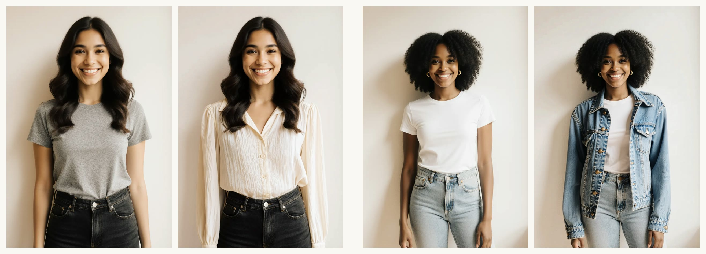
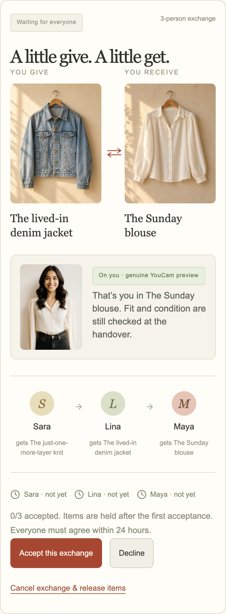
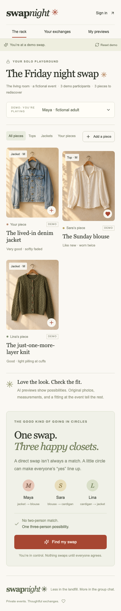
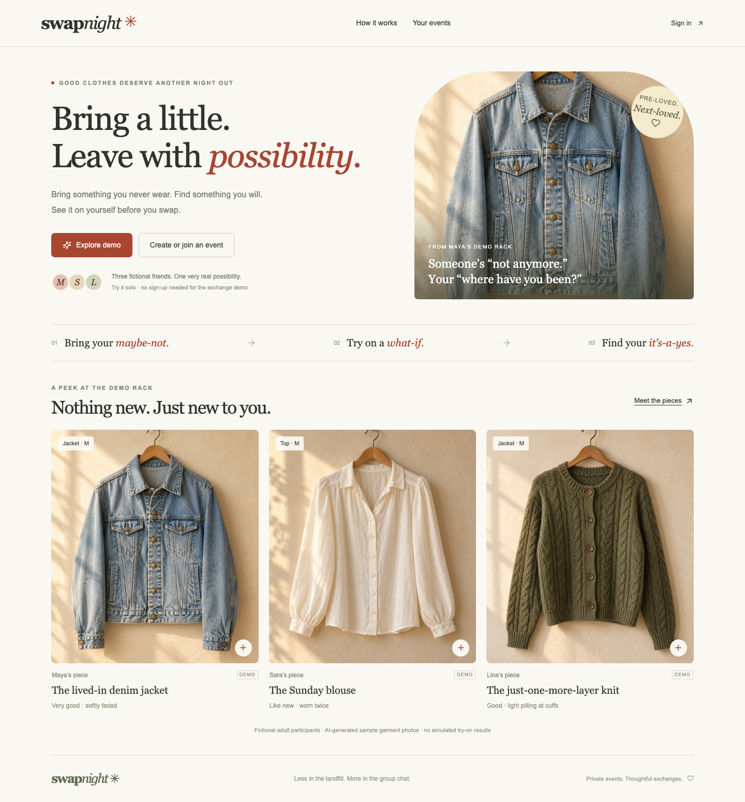

# SwapNight

[Open the deployed app](https://swapnight.trevorsuna-c38.workers.dev) · [Three-minute walkthrough](docs/DEMO.md)

**Swap clothes that suit you. See them on you first.**

A mobile-first private clothing-swap application for the YouCam Skin AI & eCommerce VTO Hackathon. Anyone can try the full exchange lifecycle alone in the built-in demo, using clearly labeled fictional adults.

## Product

- Private events and invitation links; Supabase email/password Auth.
- Tops and jackets with original photos, size, condition, and measurements.
- Explicit item-for-item preferences; deterministic two- and three-person cycle matching.
- Clear “You give / You receive” proposals and individual acceptance, with your own YouCam try-on of the piece you would receive shown right above **Accept** (or a **See it on me first** shortcut to make one).
- Atomic reservations, conflict handling, rejection, cancellation, and expiry.
- Fitting/condition/physical-handover checklist; completion requires every participant.
- **Colors that love you:** one close-up selfie → YouCam AI Facial Color Tones Analyzer → SwapNight’s own undertone/season logic. The rack sorts **Flatters you first**, every garment gets a match badge, and the proposal card shows the match right above **Accept**.
- Real YouCam Clothes v4 generation, persisted task IDs, resumable polling, private result storage, and photo/result deletion.
- Isolated browser-local **Explore demo**, fictional Maya/Sara/Lina switcher, and repeatable reset.

The demo seed has no two-person match and exactly one three-person match: Maya’s jacket → Sara’s blouse → Lina’s cardigan → Maya’s jacket. Demo exchanges and handovers are simulated. Sample garment photos were generated for this project; they are not YouCam results.

## Screenshots

**Genuine YouCam AI Clothes results**, generated through the deployed app: Maya in Sara’s blouse (`upper_body`) and Lina in Maya’s denim jacket (`outer`). The person photos are AI-generated fictional adults; the try-ons are unedited YouCam output.



| See it before you say yes | The private rack | Landing |
| --- | --- | --- |
|  |  |  |

## Stack

Next.js 16 + TypeScript, Tailwind v4, shadcn-style Radix Button, Supabase Auth/Postgres/private Storage, YouCam REST API, and Cloudflare Workers via `@opennextjs/cloudflare`. OpenNext uses Workers static assets and no ISR cache. Browser-local demo state never writes to real events.

## Start locally

Use Node 22 LTS or newer supported LTS and npm.

```sh
npm ci
cp .env.example .env.local
# Fill in the four values without committing secrets.
npm run dev -- --port 3001
```

Variables:

| Variable | Purpose |
| --- | --- |
| `NEXT_PUBLIC_SUPABASE_URL` | Supabase project URL |
| `NEXT_PUBLIC_SUPABASE_ANON_KEY` | Public anon/publishable key for Auth |
| `SUPABASE_SERVICE_ROLE_KEY` | Server-only service-role/secret key |
| `YOUCAM_API_KEY` | Server-only Perfect Corp key with AI Clothes credits |

Without a YouCam key, exchanges still work. Live generation returns an honest setup error; it does not render a placeholder as an API result.

## Supabase setup

The migration `supabase/migrations/202609300001_swapnight.sql` creates `sn_events`, `sn_members`, `sn_media`, `sn_previews`, transactional RPC functions, and the private `swapnight` bucket. It is additive, so it can be applied to a new or existing Supabase project without affecting other tables or buckets.

```sh
npx supabase@latest login
npx supabase@latest link --project-ref YOUR_PROJECT_REF
npx supabase@latest db push --dry-run
npx supabase@latest db push
```

For email confirmation, configure Supabase Auth URL settings with the deployed site URL and allow `https://YOUR_HOST/auth/callback` plus `http://localhost:3001/auth/callback` for local development. Email/password signup is enabled; keep email confirmation enabled. Existing accounts can sign in on any device.

## Matching, concurrency, and privacy

`lib/swap/engine.ts` is the pure deterministic engine. It never infers willingness from a like or an AI model. A preference means a named owner explicitly accepts one named garment for one item they own. Each valid cycle uses two or three different owners in one event.

Each live event is one Postgres transaction boundary. Server-side commands validate Auth identity, event membership, ownership, availability, and explicit preferences. `sn_commit` locks the event row and compares revisions. Stale commands retry against the new state, up to five times. Reservation and proposal status updates are committed together. Conflicting proposals are cancelled when the first acceptance reserves their shared items. Duplicate request IDs, acceptances, and handovers are idempotent.

Proposals expire after 24 hours, evaluated on reads and mutations. The first acceptance holds all items; all acceptances move the proposal to `reserved`. Acceptance never means completion. After one physical handover is confirmed, cancellation and automatic expiry are blocked to avoid releasing items already handed over. All participants must confirm before `completed`.

RLS and grants deny direct anon/authenticated access to app tables. Only server routes use the service key, and every relevant query is scoped to the authenticated user and event. Private images use 15-minute signed URLs. Personal source photos and previews are only accessible to their owner. The delete control removes both objects; a minimal task tombstone retains the usage count. A withdrawn garment remains in event history and is not offered for matching.

## YouCam

The app checks JPG/PNG signatures and dimensions: at least 512 × 384, no side above 4096, up to 4 MB. The provider performs pose and person validation. Tops use `upper_body`; jackets use `outer`. One garment per preview. All photos stay private except the explicitly public generated demo garment assets.

A database quota claim is made before starting a paid task (five claims per account per rolling 24 hours, including failures). Duplicate request IDs reuse the task. Provider task IDs are persisted; status checks resume from My previews after reload. Polling is at least ten seconds apart with a 36-poll/30-minute bound. A crash before the provider ID is saved leaves a bounded failed/starting task rather than silently submitting twice. A successful result is downloaded with a bounded 15 MB reader and stored in Supabase instead of depending on the provider’s temporary URL.

Try-on is an **appearance preview, not a fit guarantee**. Original garment details remain visible.

Once a preview succeeds, the proposal card shows it next to **Accept** for the piece you would receive, so the decision to swap is made after seeing it on you. Previews are private to the signed-in account and keyed by garment, so in the solo demo one account can see its own try-on while playing each participant.

## Colors that love you (second YouCam API)

A swap only closes when enough people say “yes” to enough pieces. The hardest yes is *“will this color even suit me?”* SwapNight answers it before anyone tries anything on.

1. **YouCam AI Facial Color Tones Analyzer** (`POST /s2s/v2.0/task/skin-tone-analysis`, then polling) reads one close-up selfie and returns hex values for skin, lips, brows, hair and eyes, plus eye and hair color names. The selfie is streamed to YouCam and **never stored by SwapNight**. Only those hex tones are kept, in `sn_tones`, and the user can delete them at any time.
2. **Our palette logic** (`lib/swap/palette.ts`, pure and unit-tested) does the rest. YouCam does not return undertone or season. We convert the tones to OKLab/OKLCH. Skin hue, nudged by hair and eye color, gives the undertone (warm, neutral or cool). Skin lightness gives depth. The skin-to-hair lightness gap gives contrast. Those map to a 4-season palette.
3. Each garment has a main color. It is auto-detected in the browser from the upload, ignoring the backdrop, and the owner can adjust it. It is scored by perceptual distance to the wearer’s palette, with a smaller credit for the sister season. The three tiers are **Flatters you**, **Works on you** and **Bold pick**. We never call a color “wrong”.

Guardrails: the analysis runs once per selfie and is cached per account. A Postgres claim allows 3 analyses per rolling day (20 units each) and blocks a second run while one is pending. Every task is polled to completion: inline for about 40 s, then resumed by `GET /api/tone`. An unpolled task can time out and still consume units. YouCam `error_face_*` codes become friendly retake prompts. The solo demo uses clearly labeled fictional sample tones for Maya, Sara and Lina, so it needs no account and makes no API call.

Apply `supabase/migrations/202611010001_tones.sql` (additive) to enable live analysis. Until then the app works, and live color analysis reports that it is unavailable.

## Solo demo and reset

Click **Explore demo**. Select Maya, Sara, or Lina using **Demo participant**. Click **Find my swap**, accept as each person, and confirm the fitting/handover checklist as each person. **Reset demo** restores the original scenario and clears only this browser’s simulated state. Different visitor/browser profiles have separate demo state. Same-origin tabs in one browser profile share the local demo collection; do not use them to simulate independent visitors. `seedDemo()` is the repeatable seed used by the UI and tests.

For a guided tour of the full exchange lifecycle, follow the [three-minute walkthrough](docs/DEMO.md).

## Verification

Verified results:

- Next.js production build and OpenNext Cloudflare Workers bundle pass; TypeScript passes.
- 21 Vitest tests pass: deterministic matching, lifecycle, reservation conflicts, ownership, idempotency, migration/RPC transactions and grants, quotas, and image dimensions.
- 10 Playwright tests pass on local development, the local Workers production runtime, and the deployed Cloudflare URL, on desktop and mobile.
- Real Supabase integration passes against local development, the local Workers runtime, and the deployed Cloudflare URL: three disposable accounts, private events/invitations, uploads, ownership and cross-event denial, simultaneous acceptance, reservations, and physical handover.
- Server secret values are absent from public Worker assets.
- Real YouCam AI Clothes generation is verified end to end on the deployed app: upload, quota claim, provider task, resumable polling, private storage, and display in the garment view, My previews, and the proposal card. See the [screenshots](#screenshots).

```sh
npm test                       # Vitest: matching, state, Postgres RPCs, RLS, quota, image specs
npm run test:e2e                # Playwright desktop + mobile, local server on 3001
npm run test:live               # Real Supabase integration; disposable test fixtures only
npm run build:worker            # Next.js build + OpenNext Workers bundle
npm run preview:worker         # workerd on port 8787
TEST_BASE_URL=http://localhost:8787 npm run test:e2e
TEST_BASE_URL=http://localhost:8787 npm run test:live
node scripts/check-client-secrets.mjs
```

The live test creates three confirmed fictional test users and two test events, verifies ownership/membership rejection, simultaneous acceptance, handover and private storage, then deletes only those fixtures. It does not call paid YouCam generation or contact real people.

## Cloudflare deployment

```sh
npx wrangler login
npm run cf:typegen
npm run build:worker
npx opennextjs-cloudflare deploy
node scripts/publish-secrets.mjs
```

The secret script sends only the four whitelisted application environment values to Wrangler over stdin and never prints the values. For local Workers secret overrides, copy `.dev.vars.example` to `.dev.vars`. Use `npm run deploy` for subsequent source deployments.

## License

[MIT](LICENSE)

## Official references

- [Cloudflare Next.js on Workers](https://developers.cloudflare.com/workers/framework-guides/web-apps/nextjs/)
- [OpenNext Cloudflare setup](https://opennext.js.org/cloudflare/get-started)
- [YouCam AI Clothes integration guide](https://docs.perfectcorp.com/reference/ai_clothes/section/overview/integration-guide)
- [YouCam AI Facial Color Tones Analyzer](https://docs.perfectcorp.com/reference/ai_skin_tone_analysis)
- [Supabase private storage](https://supabase.com/docs/guides/storage/buckets/fundamentals)

Out of scope: payments, shipping, public discovery, social feeds, and native apps. Color guidance only suggests; it never creates a preference or a swap.
